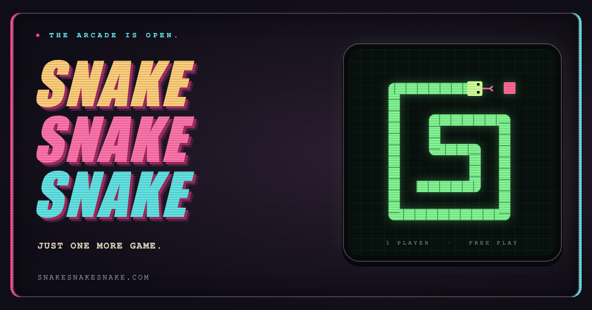

# SNAKE SNAKE SNAKE

[](https://snakesnakesnake.com/)

**The arcade is open. You're up next.**

Step up to a neon-lit cabinet, chase the pink food, and see how long you can keep your snake alive. The walls are unforgiving. So is your own tail.

## 🕹️ [Press start](https://snakesnakesnake.com/)

One player. Free play. Just one more game.

## Inside the cabinet

- **That CRT glow.** Green phosphor graphics, scanlines, and screen reflections, framed by an amber marquee and pink and cyan trim.
- **Controls you can press.** Steer with the cabinet's direction pad. The big pink button starts, pauses, resumes, and restarts the game.
- **A score worth chasing.** Your best score survives the next visit, saved in a browser cookie. Current and high scores sit above the screen.
- **A little light show.** The cabinet glow changes every 10 points as you work through a palette of 15 colors.
- **Snake in the browser tab.** An animated favicon chases its own pink food. It pauses in background tabs and stays still when reduced motion is enabled.
- **Even a wrong turn belongs here.** Missing pages get a custom 404 made from three glowing snakes, with a way back to the arcade.

## Eat. Grow. Repeat.

Start the game, collect the pink food squares, and keep moving. Each bite earns a point and makes your snake longer. Hit a wall or your own body and it's game over.

| Action | Keyboard | Touch | Cabinet controls |
| --- | --- | --- | --- |
| Start | Space | Tap the screen | Pink button |
| Steer | Arrow keys | Swipe | Direction pad |
| Pause / resume | Space | Tap the screen | Pink button |
| Play again | Space after game over | Tap after game over | Pink button |

The cabinet resizes for desktop, tablet, and phone screens. Touch devices get their own control instructions.

<details>
<summary>The cabinet's color progression</summary>

| Score | Glow |
| --- | --- |
| 0–9 | Phosphor green |
| 10–19 | Dark blue-gray |
| 20–29 | Purple |
| 30–39 | Red |
| 40–49 | Orange |
| 50–59 | Yellow |
| 60–69 | Green |
| 70–79 | Blue |
| 80–89 | Light purple |
| 90–99 | Dark orange |
| 100–109 | Teal |
| 110–119 | Dark gray |
| 120–129 | Dark red |
| 130–139 | Burnt orange |
| 140–149 | Dark teal |

After that, the palette cycles through the 15 colors, starting with dark gray. A new game resets the glow to phosphor green.

</details>

## Open the back panel

HTML5 Canvas draws the game. Vanilla JavaScript handles the snake, scoring, and keyboard and touch controls. CSS builds the cabinet. The game moves at a classic 10 FPS, and everything runs in the browser.

### Run it locally

Clone the repo:

```bash
git clone https://github.com/swinton/snake.git
cd snake
```

Open `index.html` directly, or start a local server:

```bash
# Using Python 3
python -m http.server 8000

# Using Node.js
npx serve
```

For the Python server, open [localhost:8000](http://localhost:8000). With `npx serve`, use the URL it prints.

### Share the cabinet

The homepage includes Open Graph and Twitter Card metadata with an absolute HTTPS image URL. `social-preview.png` is a 1200 × 630 PNG styled to match the arcade cabinet. Messaging apps can cache previews, so previously shared messages may retain the older preview.

### Deploy to Render

This game runs entirely in the browser and deploys as a [Render Static Site](https://render.com/docs/static-sites). No server, database, environment variables, or dependencies are required.

The live deployment uses `snakesnakesnake.com`, registered and managed through Cloudflare. Both the apex and `www` have DNS-only CNAME records pointing to `snake-qez4.onrender.com`; Render redirects `www` to the apex and manages HTTPS certificates.

To inspect or redeploy the existing service from a terminal after signing in with `render login`:

```bash
render workspace set tea-dbk49gs9v7es73blmdfg --confirm
render deploys list srv-dbnpiq5g1s2s73db87m0 --output json
render deploys create srv-dbnpiq5g1s2s73db87m0 --wait --confirm
```

To create a separate deployment:

1. Commit and push `render.yaml` along with the application files to your GitHub repository.
2. In the [Render Dashboard](https://dashboard.render.com/), select **New > Blueprint** and connect your repository.
3. Select the branch containing `render.yaml`, review the `snake` static site, and deploy it.
4. Once deployment finishes, open the `onrender.com` URL shown by Render.

The Blueprint copies `index.html`, `404.html`, `snake.js`, `favicon.svg`, `favicon.js`, and `social-preview.png` into `dist/` and publishes that directory. The favicon animates while the tab is visible and uses a static icon when reduced motion is enabled. Render automatically deploys subsequent pushes to the linked branch. See [Render's Blueprint setup guide](https://render.com/docs/infrastructure-as-code) for details.

If you prefer **New > Static Site**, use these settings:

| Setting | Value |
| --- | --- |
| Build Command | `mkdir -p dist && cp index.html 404.html snake.js favicon.svg favicon.js social-preview.png dist/` |
| Publish Directory | `dist` |

High scores are saved in browser cookies for the site's domain, so scores from the GitHub Pages site won't transfer to the Render URL.

### Project structure

```
snake/
├── index.html          # Main HTML file and game container
├── 404.html            # Arcade-themed page for missing URLs
├── snake.js            # Game logic, controls, and rendering
├── favicon.svg         # Static snake favicon and reduced-motion fallback
├── favicon.js          # Animated tab icon
├── social-preview.png  # Open Graph and messaging link preview
├── render.yaml         # Render Static Site deployment configuration
├── README.md           # This documentation
└── LICENSE             # MIT license
```

### How the game fits together

`SnakeGame` in `snake.js` owns the snake, food, score, collision detection, and the waiting, playing, paused, and game-over states. Keyboard, touch, and cabinet inputs feed the same controls; the Canvas render loop draws the result and updates the score panel.

## Got another idea for the arcade?

Open an issue or send a pull request. Bugs, gameplay ideas, cabinet details, and documentation fixes are all welcome.

Inspired by classic Nokia Snake. Built for one more game.

[MIT licensed](LICENSE). **No coins needed.**
